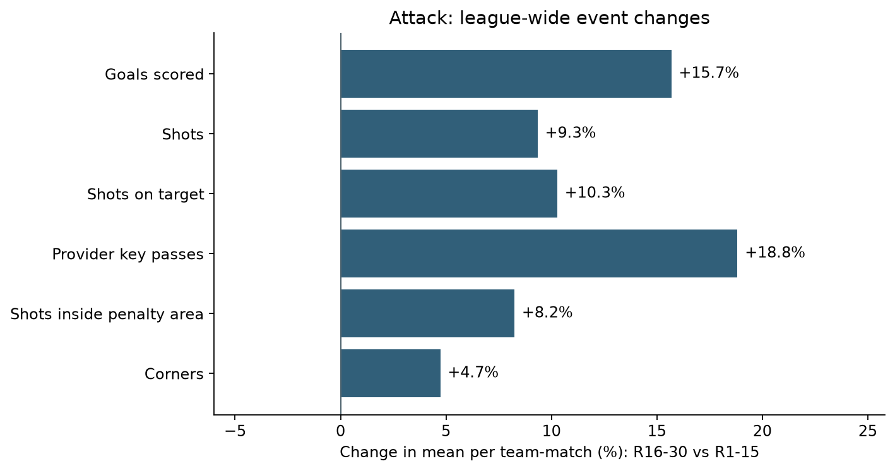

# K리그1 2026: 월드컵 휴식기 전후 비교

[English](README.md) | [한국어](README.ko.md)

**휴식기 이후 리그 전체 경기 기록과 구단 성적은 어떻게 달라졌을까?**

1~15라운드와 16~30라운드를 비교합니다. 먼저 리그 전체를 보고, 이어서 FC안양, 대전하나시티즌, 제주SK 세 구단 사례를 살펴봅니다.

관찰된 변화를 설명하는 기술 분석이며, **예측 모델이나 휴식기의 인과 효과 추정이 아닙니다**. 세 구단은 순위 변화를 본 뒤에 골랐습니다.

## 결과 한눈에 보기

- 리그 전체의 팀당 경기당 득점은 15.7%, 슈팅은 9.3% 늘었고, 패스 시도는 3.6% 줄었습니다.
- **안양:** 실점이 16골에서 31골로 늘었습니다. 서울전 0-7 패배를 빼도, 휴식기 후 14경기와 휴식기 전 15경기를 비교하면 경기당 약 0.65골 더 실점했습니다.
- **대전:** 득점이 17골에서 29골로 늘었고, 무득점 경기는 7경기에서 2경기로 줄었습니다.
- **제주:** 경기당 유효 슈팅은 줄고 허용한 유효 슈팅은 늘었는데도, 패배가 7번에서 1번으로 줄었습니다. 슈팅 수만으로는 성적 개선을 설명할 수 없습니다.



실제로 얻은 것은 경기 리뷰에서 볼 질문을 좁힌 목록입니다. 안양은 어디서 유효 슈팅을 허용했는지, 대전은 어떤 경기에서 슈팅이 많으면서도 여러 골을 내줬는지, 제주의 패배 감소에는 어떤 경기 상황이 함께 있었는지입니다.

## 4단계 학습 과정

`v1`~`v4`는 **하나의 분석을 배우며 진행한 단계**입니다. 서로 경쟁하는 네 개의 모델이나 꾸며낸 개발 이력이 아닙니다. 각 단계에는 영어로 된 Python 스크립트와, 같은 코드를 실행한 Jupyter 노트북이 있습니다.

| 단계 | 질문 | 노트북 | 주요 결과물 |
|---|---|---|---|
| v1 — 데이터 준비 | 입력이 빠짐없고 올바르게 합쳐졌나? | [데이터 준비](notebooks/v1_prepare_data.ipynb) | 검증된 팀-경기 데이터 |
| v2 — 리그 전체 | 공격·수비·패스·순위는 어떻게 달랐나? | [리그 전체](notebooks/v2_league_overview.ipynb) | 지표 43개 사전, 리그·팀 비교, 순위표, 차트 |
| v3 — 구단 비교 | 안양·대전·제주는 어떻게 다른가? | [관심 구단](notebooks/v3_focus_teams.ipynb) | 승무패 정리, 무득점 경기, 리뷰 그룹, 구단 차트 |
| v4 — 민감도 점검 | 해석이 특정 한 경기나 일정 구성에 좌우되나? | [견고성 점검](notebooks/v4_robustness.ipynb) | 승점 평균 재가중, 경기 분포, 한 경기 제외 범위 |

노트북은 순서대로 읽어 주세요. 소스 코드는 [`scripts/`](scripts/)에, 공통 경로와 차트 설정은 [`project_config.py`](project_config.py)에 있습니다.

## 범위와 정의

| 항목 | 정의 |
|---|---|
| 대회 | K리그1, 2026 |
| 기준 구간 | 1~15라운드 |
| 비교 구간 | 16~30라운드 |
| 범위 | 180경기, 팀-경기 관측 360개, 12개 구단 |
| 구단 분모 | 구간마다 구단당 15경기 |
| PPG | 승점 ÷ 경기 수 |
| 횟수 지표 | 구간 합계 ÷ 실제 팀-경기 관측 수 |
| 비율 지표 | 분자 합계 ÷ 분모 합계 (경기별 비율의 평균이 아님) |
| %p 변화 | 두 비율의 차이. 상대 변화율(%)과는 다름 |
| 순위 | 1~15라운드 누적 vs 1~30라운드 누적 |

**22라운드**로 배정되어 **2026년 9월 27일**에 열린 강원–인천 경기는 휴식기 후 구간에 한 번만 포함했습니다. 실제 경기 날짜는 그대로 유지했습니다. 1~30라운드 순위는 이 연기 경기를 포함하며, 원래 30라운드가 끝난 날의 순위표를 다시 만든 것은 아닙니다. ACL 일정에 따른 피로, 휴식, 로테이션은 보정하지 않았습니다.

16~30라운드만으로 만든 표는 **분석용 폼 순위표**이며, 공식 누적 리그 순위표가 아닙니다. 항목별 표는 기록된 지표 값의 순위일 뿐, 팀의 종합 실력 점수를 만들지 않습니다. 수비 이벤트 횟수는 점유율이나 수비 기회 수로 보정하지 않았습니다.

## 데이터와 재현성

출처: [K리그 공식 데이터 포털](https://data.kleague.com/). **2026년 9월 30일**에 점검한 저장 스냅샷을 사용합니다. 실행해도 웹사이트를 새로 수집하거나 이후 수정된 원본을 확인하지 **않습니다**.

재배포 허락을 확인하지 못해 제공처 원본 파일은 **공개 저장소에 포함하지 않았습니다**. 재배포가 금지되어 있다는 뜻이 아니라 배포 방식에 대한 선택입니다. 필요한 파일 4개와 스냅샷 해시는 [`data/README.md`](data/README.md)에 있습니다. 그래서 공개 저장소를 내려받으면 저장된 노트북 결과는 볼 수 있지만, 입력 파일을 넣기 전에는 전체 과정을 다시 실행할 수 없습니다.

정리된 집계 CSV는 [`results/`](results/)에, 고른 차트는 [`figures/`](figures/)에 있습니다. 경기 단위 파일은 로컬에만 둡니다. 단계별 차트는 분석을 돕는 자료이며, LinkedIn PDF 화면을 그대로 재현한 것은 아닙니다.

### 설치

Python 3.12를 사용합니다 (3.12.14에서 확인). 패키지 버전은 `requirements.txt`에 시험한 환경 그대로 고정했고, 실행 결과는 `validation.json`에 기록되어 있습니다. 이 프로젝트 폴더에서:

```bash
python -m venv .venv
# 운영체제에 맞게 .venv를 활성화한 뒤:
python -m pip install -r requirements.txt
python -m ipykernel install --user --name kleague-break --display-name "K League Break"
```

필요한 입력 파일을 `data/raw/`에 넣고 실행합니다:

```bash
python run_all.py
python tests/check_results.py
```

또는 스크립트를 순서대로 하나씩 실행합니다:

```bash
python scripts/v1_prepare_data.py
python scripts/v2_league_overview.py
python scripts/v3_focus_teams.py
python scripts/v4_robustness.py
```

노트북은 VS Code나 Jupyter에서 설치한 Python 커널을 고른 뒤 v1부터 v4까지 위에서 아래로 실행합니다. `requirements.txt`는 커널과 실행 라이브러리만 설치하고 JupyterLab 화면은 설치하지 않습니다. 이미 쓰는 노트북 편집기를 사용하거나 필요하면 JupyterLab을 따로 설치해 주세요.

결과는 이 프로젝트의 `outputs/` 폴더에 저장됩니다. **바탕화면 같은 고정 경로가 아닙니다**. 선택 환경 변수 `KLEAGUE_DATA_DIR`, `KLEAGUE_OUTPUT_DIR`로 입력·출력 폴더를 바꿀 수 있습니다. 원본 파일은 절대 덮어쓰지 않습니다.

## 품질 판단

- 집계 전에 필요한 경기 수, 고유 키, 라운드 범위, 1:1 결합을 확인합니다.
- 득점, 승점, 순위는 최종 스코어를 사용합니다. 원본 `GOAL_CNT` 값은 7개 구단에서 최종 스코어 득점과 맞지 않습니다. 이 값을 확인된 자책골 제외 값으로 바꿔 부르지 않았습니다.
- `ATT_AREA_ENTER`, `EXTRA_ATT_AND_KEYPASS_ACC`, `CONTROL_UNDER_PRESSURE`는 이 스냅샷에서 모두 0이라 분석 지표에서 뺐습니다.
- 저장된 공식 대조 파일을 현재 입력 합계와 비교합니다. 실시간 원본 확인은 아닙니다.
- 순위는 승점, 득점, 득실차, 승리 수로 정합니다. 그래도 동률이 남아 추가 규칙이 필요하면 코드가 멈춥니다.
- 한 경기 제외 점검은 한 구간에서 한 경기씩 빼 봅니다. 이 범위는 **신뢰구간이 아닙니다**.
- 홈·원정 균형 점검과 공통 상대 점검은 **PPG에만** 적용합니다. 모든 이벤트 지표를 보정하지 않으며 인과 모델도 아닙니다.

## 한계

15경기씩으로 일부러 범위를 좁힌 작은 구간입니다. 구단 선택은 결과를 본 뒤에 했습니다. 기온, 습도, 휴식, 대표팀 차출, 선발 명단, 스코어 상황, xG는 보정하지 않았습니다. 횟수만으로는 기회의 질, 결정력, 골키퍼 경기력, 전술 원리를 증명할 수 없습니다. 통계적 유의성이나 예측에 대한 주장은 하지 않습니다.

한 경기에서 나온 두 팀의 행은 서로 연결된 관측이며 독립 표본이 아닙니다. 360개 행을 360개의 독립 경기로 다루는 추론 모델은 쓰지 않았습니다.

## 다음 계획 — 2026 시즌 종료 후

**2026 K리그1 시즌이 끝나면 이 프로젝트를 다시 열어 시즌 종료 분석을 공개할 계획입니다.**

1. 시즌 끝까지의 공식 경기 결과와 기록을 새로 받아, 최종 승점·득점·득실차·순위를 대조합니다.
2. 이 1~30라운드 스냅샷은 원래 비교로 그대로 두고, 시즌 종료 확장 분석은 따로 추가해 두 범위를 구분할 수 있게 합니다.
3. 리그 전체 패턴과 세 구단의 변화가 남은 경기에서도 이어졌는지, 약해졌는지, 뒤집혔는지 확인합니다.
4. 마지막 라운드 그룹과 서로 다른 상대 일정을 분명히 다룹니다. 지금의 15 대 15 비교에 경기 수가 다른 구간을 그냥 붙이거나, 길이가 다른 구간의 합계를 그대로 비교하지 않습니다.
5. 풀리지 않은 구단별 질문은 가능하면 경기 영상이나 추가 맥락 데이터로 다시 봅니다. 그런 자료를 꼭 구할 수 있다거나, 그것으로 인과를 밝힐 수 있다고 가정하지 않습니다.

이 항목들은 계획이며, 완료된 분석이나 예약된 자동 업데이트가 아닙니다.

## 만든 사람과 구현

[LinkedIn — Minseob Eom](https://www.linkedin.com/in/minseob-eom-97b410375/) · [GitHub](https://github.com/madferit94)

프로젝트 질문, 데이터 수집, 관심 구단 선정은 Minseob Eom이 했습니다. Python 구현, 문서 작성, 발표 자료에는 AI의 도움을 받았습니다. 이 파이프라인은 실행 가능한 검사와 추적 가능한 계산을 담고 있으며, 혼자서 모든 코드를 작성했다고 주장하지 않습니다.
